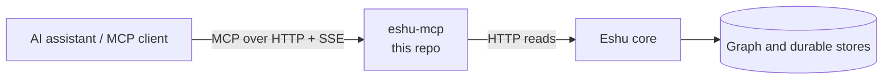

# eshu-mcp

Status: pre-release. You can build and run it today, but don't treat it
as the final production setup yet.

`eshu-mcp` lets AI assistants use Eshu as tools. MCP (Model Context
Protocol) is the standard way assistants call tools, where a tool is one
named action like "find this code" or "list repositories". Eshu maps
code and cloud systems into a graph, and this server puts that map
behind MCP over HTTP: your assistant calls a tool, we turn it into a
read against the Eshu core, and the result comes back in MCP shape. This
repo owns the tool registry, the protocol handling, and dispatch. The
core owns the data and decides who's allowed in. We import no core
storage code and reach the core only over HTTP.



In short: your client connects here, lists tools, and calls one. We
forward your credential to the core with each call, and the core has the
final say on access.

## Is this the repo you want?

Use it to run the MCP server as its own process, to work on tool
definitions or result shapes, or to connect an editor or agent to Eshu
over HTTP.

Skip it when you want terminal commands (use `eshu-cli`), the plain HTTP
API (use `eshu-api` or the core), changes to stored data or access rules
(the core again), or one command for the whole stack (see
[eshu-deploy](https://github.com/eshu-hq/eshu-deploy)).

## Quickstart

You'll need Go 1.26.10 (see `go.mod`) and a running core. The shared key
below is the simplest of the three credential options.

```bash
go build -o /tmp/eshu-mcp ./cmd/eshu-mcp
ESHU_API_KEY='change-me' /tmp/eshu-mcp --core-base-url http://localhost:8080
curl -s http://localhost:8080/health
curl -s http://localhost:8080/healthz
```

`--core-base-url` is required, and with no credential source set the
server refuses to start. That refusal is deliberate.
[Configuration](docs/reference/configuration.md) walks through your options. When
`/health` answers `{"status":"ok"}` and `/healthz` shows a non-zero
tool count, point your client at `GET /sse` and `POST /mcp/message`
with an `Authorization: Bearer <token>` header on both.

## Documentation

| Guide | What you will find |
| --- | --- |
| [Documentation index](docs/README.md) | The map of every page below |
| [Getting started](docs/getting-started/README.md) | Run the server and connect your first client |
| [Guides](docs/guides/README.md) | Operate, auth setup, and troubleshooting, step by step |
| [Concepts](docs/concepts/README.md) | Where this sits, how a tool call travels, surfaces and result shapes |
| [Configuration reference](docs/reference/configuration.md) | Every flag and env var, and the three ways to give it a credential |
| [Architecture](docs/architecture/README.md) | Place in Eshu, components, and stack |
| [Diagrams](docs/diagrams/README.md) | Every diagram, with captions and text versions |
| [Operating: SSE session limits](docs/operations.md) | Session caps, refusal shape, and what to watch — read before a shared-key deploy |
| [What this build serves](docs/skeleton.md) | Scope of the current build |
| [Release](docs/release.md) | Tags, images, and how to check a published digest |
| [Tool registry contract](contracts/tool-registry/v1/tools.json) | The 172 tools, in contract order, with pinned read bounds |
| [Shared shapes](contracts/shared-shapes/v1/SHARED_SHAPES.md) | Wire shapes shared with the other Eshu surfaces |
| Maintainer history: [parity](docs/parity.md), [provenance](docs/provenance.md), [cutover ownership](docs/source/CUTOVER_OWNERSHIP.md), and QA notes in `docs/qa/` | What moved where, source pins, and parity evidence |

## Related repos

`eshu` holds the core. `eshu-api` is the HTTP front door, `eshu-cli` is
the command line (its `mcp setup` command can write client config for
you), and [eshu-deploy](https://github.com/eshu-hq/eshu-deploy) runs the
full stack.

## Development

`make ci` runs the same checks as CI (vet, lint, fmt, tidy, cap, build,
test, race). It needs `golangci-lint` v2.12.2, and Go files stay at or
under 500 lines.

## Contributing, security, and license

See [CONTRIBUTING.md](CONTRIBUTING.md) for the local checks. There's no
`SECURITY.md` or `LICENSE` file here. If you find a security issue,
please tell the maintainers privately rather than opening a public
issue. And never commit credentials.
