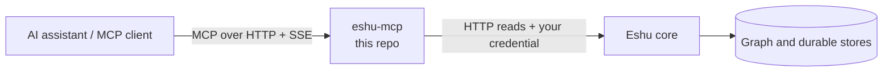

# eshu-mcp

Status: pre-release. You can build and run this server
today. Do not treat it as the final production setup yet.

`eshu-mcp` lets AI assistants use Eshu as tools, over HTTP.

## What this is and why it exists

MCP (Model Context Protocol) is a standard way for AI
assistants to call tools. A tool is one named action,
like "find this code" or "list repositories."

Eshu maps code and cloud systems into a graph (things
and how they connect). This server exposes that map as
MCP tools. Your assistant calls a tool. This server
turns it into an HTTP read against the Eshu core.
It returns the result in MCP shape.

This repo owns the MCP layer only:

- The tool registry (the list of tools and their order).
- Protocol handling for MCP over HTTP and SSE.
  SSE (Server-Sent Events) is a long-lived stream the
  client holds open while it is connected.
- Dispatch: sending each tool call to the core and
  shaping the reply.

The core owns the data. It owns the graph, the stores,
and who is allowed in. This server imports no core
storage code. It reaches the core only over HTTP.

## How it fits together



Text version: your MCP client connects to `eshu-mcp`.
It lists tools, then calls one. `eshu-mcp` forwards
your credential to the core with each call. The core
decides access and returns data. `eshu-mcp` shapes
that data as an MCP tool result.

## When to use it, and when not to

Use this repo when you:

- Run the MCP server as its own process or container.
- Work on tool definitions, routing, or result shapes.
- Connect an editor or agent to Eshu over HTTP.

Do not use this repo when you:

- Want terminal commands. Use `eshu-cli` instead.
- Want the plain HTTP API. Use `eshu-api` or the core.
- Need to change stored data or access rules. That
  lives in the core.
- Want one command that runs the whole stack. See
  [eshu-deploy](https://github.com/eshu-hq/eshu-deploy).

## Quickstart

You need Go. Use the version in `go.mod` (Go 1.26.10).
You also need a running Eshu core to read from.

Build and run. Pick one credential source (the shared
key is the simplest):

```bash
go build -o /tmp/eshu-mcp ./cmd/eshu-mcp
ESHU_API_KEY='change-me' /tmp/eshu-mcp \
  --core-base-url http://localhost:8080
```

`--core-base-url` is required. With no credential source
set, the server refuses to start. That is on purpose.
See Configuration for the three ways to set one.

Check that it works:

```bash
curl -s http://localhost:8080/health
curl -s http://localhost:8080/healthz
```

You should see:

```json
{"status":"ok"}
```

`/healthz` returns a JSON object with the contract
version, the advertised tool count, your core URL, and
SSE session counts. Confirm the tool count is not zero
before you connect a client.

Connect your client to this server over HTTP:

- Stream endpoint: `GET /sse`
- Message endpoint: `POST /mcp/message`

Send your credential as `Authorization: Bearer <token>`
on both. Your client then runs `initialize` and
`tools/list` for you. Use your client's own config
format to store the URL and header. Do not paste raw
secrets into shared config files. Use an env-var
reference if your client supports one.

## How it works

Requests in (JSON-RPC, the message format MCP uses):

- `initialize` — client and server agree on versions.
- `tools/list` — server returns the tools it advertises.
- `tools/call` — client runs one tool by name.

The registry holds 171 tools, counted from
[tools.json](contracts/tool-registry/v1/tools.json)
(`registry.tool_count`, contract `v1`). Names and order in that
file are part of the contract. Two router tools, `find_tool` and
`call_tool`, help clients search the list. What `tools/list`
advertises depends on `ESHU_MCP_TOOL_SURFACE`. A direct call to a
registered tool still works on every surface.

Responses out: each call goes to the core over HTTP with your
credential forwarded as-is. The core decides access. Reads are
bounded at 30s and 262144 bytes, per the contract file. Results
use `application/eshu.envelope+json`, laid out as `dual` by
default or `structured` if you set it (see Configuration).

## Configuration

| Name | Required | Default | Meaning |
| --- | --- | --- | --- |
| `--addr` | No | `:8080` | Address and port to listen on. |
| `--core-base-url` | Yes | none | Core read-API origin, for example `https://core:8443`. Startup fails if empty. |
| `ESHU_API_KEY` (env) | One of three* | empty | Shared key. Callers who present it share one identity. |
| `ESHU_SCOPED_TOKENS_FILE` (env) | One of three* | empty | Path to the scoped-token file. |
| `ESHU_AUTH_RESOURCE_URI` (env) | One of three* | empty | OAuth resource URI. Enables token checks at the edge when paired with issuers below. |
| `ESHU_AUTH_AUTHORIZATION_SERVERS` (env) | No | empty | Space-separated issuer URLs for OAuth discovery. |
| `ESHU_MCP_ALLOW_UNAUTHENTICATED` (env) | No | off | `true` starts with no edge check. Local or loopback use only. Never expose this port in public with it set. |
| `ESHU_MCP_TRANSPORT` (env) | No | unset (http) | Only `http` or unset is accepted. Any other value fails startup. This binary serves HTTP only. |
| `ESHU_MCP_TOOL_SURFACE` (env) | No | `full` | `full`, `router`, or `core_router`. Controls what `tools/list` advertises. Bad values fail startup. |
| `ESHU_MCP_RESULT_SHAPE` (env) | No | `dual` | `dual` or `structured`. Controls the tool-result layout. Bad values fail startup. |
| `ESHU_MCP_QUERY_PROFILE` (env) | No | empty | Set to `production` to hide the production-hidden tools. Any other value keeps the full list. |
| `ESHU_MCP_MAX_SSE_SESSIONS_PER_PRINCIPAL` (env) | No | `32` | Open SSE sessions per identity. Must be a positive whole number. |
| `ESHU_MCP_MAX_SSE_SESSIONS_TOTAL` (env) | No | `2048` | Open SSE sessions for the whole process. Must be a positive whole number. |

\*Set at least one of the three credential sources, or
set the unauthenticated escape hatch for local use.
With none set, startup fails with an error that lists
your options. Keys travel by env only, never by flag.

## Deploy and run

The `Dockerfile` builds a small image. It compiles with
Go 1.26.10, stamps the build version, then copies the
binary onto a distroless base with no shell. The image
exposes port `8080` and starts `/eshu-mcp`.

```bash
docker build -t eshu-mcp:dev .
docker run --rm -p 8080:8080 -e ESHU_API_KEY='change-me' \
  eshu-mcp:dev --core-base-url http://host.docker.internal:8080
```

You can also run the binary directly, as in Quickstart.
Releases publish `ghcr.io/eshu-hq/eshu-mcp`. See
[release notes](docs/release.md) for tags and checks.

For a full-stack deploy (core plus every service), use
[eshu-deploy](https://github.com/eshu-hq/eshu-deploy).
This repo alone does not deploy the core.

## Eshu dependencies

|  | What |
| --- | --- |
| Needs | A reachable Eshu core at `--core-base-url`. One credential source (or the local-only escape hatch). |
| Talks to | The core over versioned HTTP read contracts. It forwards the caller's credential on every dispatch. |
| Never touches | Core stores, graph writes, or access policy. It imports no core storage handles. Reads go through HTTP, and the core stays in charge of admission (who gets in). |

## Operations

Health checks (both are public, no token needed):

- `GET /health` — `200` with `{"status":"ok"}`.
- `GET /healthz` — `200` with contract version, tool
  count, core URL, and `sse.active` / `sse.rejected`.

Watch `/healthz` after a deploy. If `sse.rejected`
grows, callers are hitting the session limit. Everyone
behind the shared key shares one limit of 32. Read
[operations](docs/operations.md) before you raise it.

Common startup failures (process exits with code `1`):

- `--core-base-url is required` — pass the flag.
- No credential posture error — set `ESHU_API_KEY`,
  `ESHU_SCOPED_TOKENS_FILE`, or
  `ESHU_AUTH_RESOURCE_URI` (or the local escape hatch).
- `ESHU_MCP_TRANSPORT=... is not supported` — use `http`
  or unset it.
- Invalid `ESHU_MCP_TOOL_SURFACE` or
  `ESHU_MCP_RESULT_SHAPE` — fix the value. A typo fails
  startup instead of falling back in silence.
- Invalid SSE limit — use a positive whole number.

Logs are JSON lines on stdout. At startup, look for
`eshu-mcp serving` with the tool count and core URL.

## Development

Run the same checks as CI:

```bash
make ci       # vet, lint, fmt, tidy, cap, build, test, race
make test     # go test ./... -count=1
make race     # go test ./... -race -count=1
python3 scripts/check-parity.py   # registry count, order, pins
```

You need `golangci-lint` v2.12.2 for `make ci`.
Go files must stay at or under 500 lines (`make cap`).

## Docs and related repos

- [Operations](docs/operations.md) — SSE session limits. Read before a shared-key deploy.
- [What this build serves](docs/skeleton.md) — scope.
- [Compatibility notes](docs/parity.md)
- [Provenance](docs/provenance.md) — source pins.
- [Release](docs/release.md) — how images are published.
- [Tool registry contract](contracts/tool-registry/v1/tools.json)
- [Shared shapes](contracts/shared-shapes/v1/SHARED_SHAPES.md)

Related: `eshu` (core), `eshu-api` (HTTP front door),
`eshu-cli` (command line; its `mcp setup` command can
write client config for you), and
[eshu-deploy](https://github.com/eshu-hq/eshu-deploy)
(full-stack deploys).

## Contributing, security, and license

See [CONTRIBUTING.md](CONTRIBUTING.md) for CI lanes and local checks.
No `SECURITY.md` or `LICENSE` file here. Report security issues
privately, not in a public issue. Never commit credentials.
