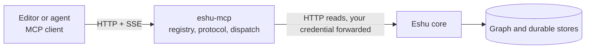
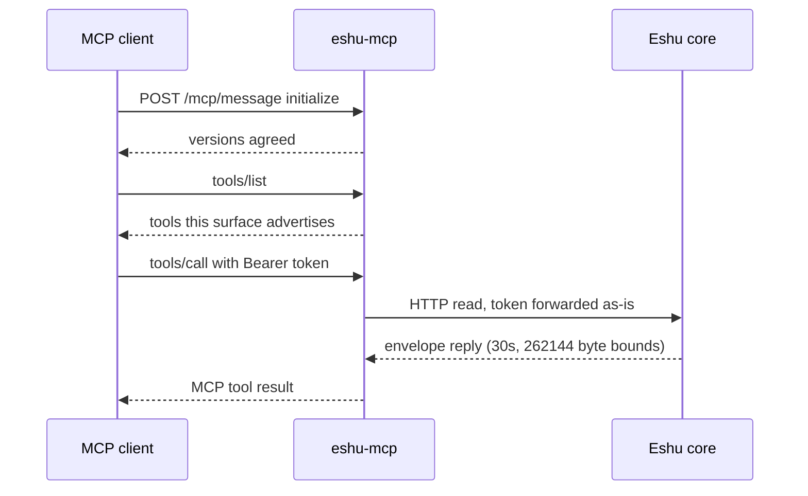

# Diagrams: eshu-mcp

Every diagram for this repo lives on this page, each with a caption and
a text version so the story survives even where Mermaid doesn't render.
Other pages link here instead of carrying their own copies. The repo
[README](../../README.md) keeps the first one as its single picture.

## Where eshu-mcp sits

*Your client, the interpreter (this repo), and the core that decides.*

Text version: an MCP client (editor or agent) talks HTTP + SSE to
`eshu-mcp`. We turn each tool call into an HTTP read against the Eshu
core, forwarding your credential so the core can judge it. The core
alone talks to the graph and durable stores. SSE (Server-Sent Events)
is the long-lived stream your client holds open while connected; tool
traffic itself goes over ordinary POSTs.

See also: [Boundaries](../concepts/boundaries.md) and
[Architecture](../architecture/README.md).

## One tool call, start to finish

*Connect, agree versions, list tools, call one.*

Text version:

1. Your client posts `initialize` to `/mcp/message`; we agree on
   protocol versions.
2. You ask `tools/list`; we answer with the tools this surface
   advertises (all 171 by default — see
   [Reference: configuration](../reference/configuration.md)).
3. You call a tool with a Bearer token.
4. The call becomes a bounded HTTP read against the core (30 seconds,
   262144 bytes) with your credential attached.
5. The core's envelope reply is reshaped into an MCP tool result.

See also: [Request story](../concepts/request-story.md).
